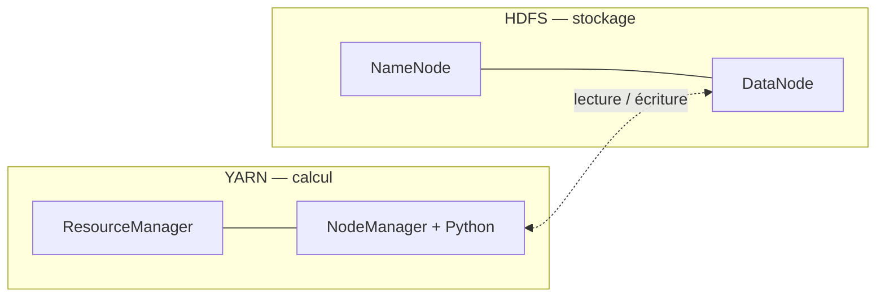

# Module Big Data — TP et projets


Travaux pratiques et projets réalisés au fil du module **Big Data** (Polytech Diamniadio – UAM, cycle ingénieur SID) : Hadoop conteneurisé (HDFS + YARN), MapReduce, puis Spark.

---

## Suivi

### Travaux pratiques

| # | TP | Thème | Technos | Statut |
|---|---|---|---|---|
| 0 | [Environnement Hadoop](tps/tp00-environnement-hadoop/) | Cluster HDFS + YARN sous Docker, premier job MapReduce Python | Hadoop 3.4.1, Docker Compose, Hadoop Streaming | ✅ Terminé |
| 2 | _TP2 Spark (03/11/2026)_ | _à ajouter_ | PySpark, Google Colab | ⏳ |
| 3 | [Préparation de données avec Spark](tps/tp03-spark-preparation-donnees/) | Nettoyage, corrélations, fuites de données et encodage MLlib sur 17 000 bâtiments | PySpark 4, Spark MLlib, Colab | ✅ Terminé |

### Projets

| Projet | Description | Technos | Statut |
|---|---|---|---|
| [Assignment 1 – Cluster Hadoop distribué](projets/assignment1-cluster-hadoop/) | Cluster 1 NameNode + 3 DataNodes + 1 ResourceManager + 3 NodeManagers, réplication 2, quatre traitements MapReduce Python validés, tests de panne | Hadoop 3.4.1, Docker Compose, Hadoop Streaming | ✅ Rendu |

---

## Environnement commun

Le dossier [`cluster/`](cluster/) contient le mini-cluster Hadoop utilisé par tous les TP :



Démarrage rapide (depuis la racine) :

```bash
docker build -t hadoop-python:3.4.1 cluster
docker compose -f cluster/compose.yaml up -d
docker compose -f cluster/compose.yaml ps
```

Interfaces : HDFS http://localhost:9870 · YARN http://localhost:8088

## Organisation du dépôt

```
module-big-data/
├── cluster/        environnement Hadoop partagé (compose, Dockerfile, XML)
├── tps/            un dossier par TP : énoncé, code, données, scripts, captures, bilan
├── projets/        projets du module (mini-projets, projet final)
├── docs/           notions transverses : architecture, interfaces web, dépannage
└── valorisation/   journal des compétences, alimenté après chaque TP
```

Nouveau TP : copier `tps/_modele-tp/` en `tps/tpNN-theme/`. Nouveau projet : copier `projets/_modele-projet/`.

## Notions documentées

- [Architecture HDFS / YARN et cycle d'un job](docs/architecture.md)
- [Interfaces web 9870 et 8088](docs/interfaces-web.md)
- [Dépannage](docs/depannage.md)

---

**Auteur :** Aliou THIAM — [aliou-thiam.info](https://aliou-thiam.info) · [GitHub @thaliou](https://github.com/thaliou)
