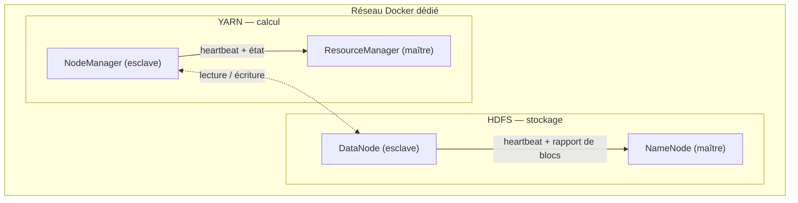
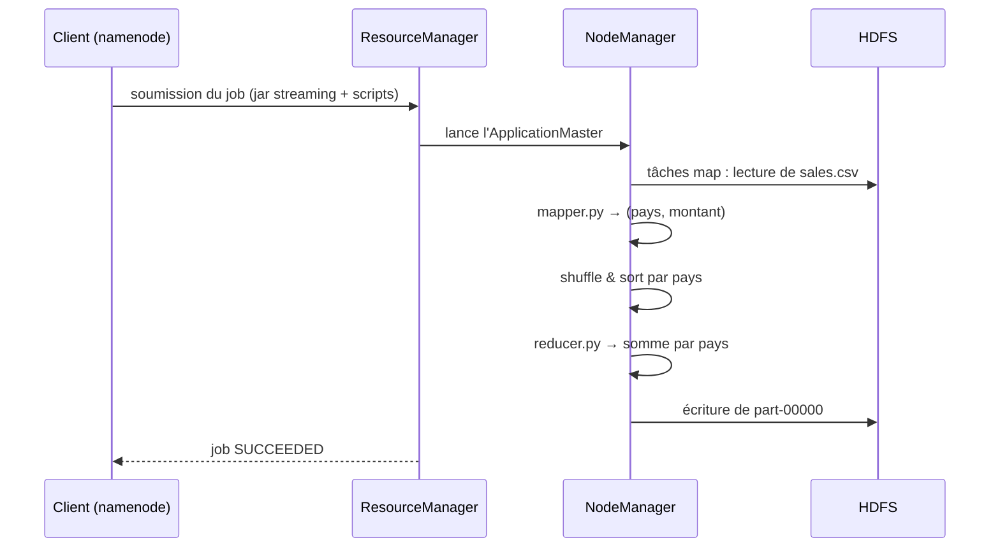

# Architecture du cluster

Le cluster est composé de deux couches indépendantes qui coopèrent :

- **HDFS** (*Hadoop Distributed File System*) : **stocke** les données.
- **YARN** (*Yet Another Resource Negotiator*) : **distribue le calcul**.

Chaque couche suit un modèle **maître / esclave**.

## NameNode — maître HDFS

L'**annuaire** du système de fichiers. Il ne stocke aucune donnée, uniquement les **métadonnées** :

- l'arborescence des répertoires et les permissions ;
- la liste des **blocs** qui composent chaque fichier ;
- le DataNode qui détient chaque bloc.

Lors d'un `hdfs dfs -put`, le client demande au NameNode *où* écrire, puis envoie les données **directement** au DataNode. Les métadonnées sont persistées dans le `fsimage` et le journal des modifications (`edits`).

Vérification : `hdfs dfsadmin -report` → `Live datanodes (1)` signifie que le NameNode reçoit bien les heartbeats du DataNode.

## DataNode — esclave HDFS

Stocke **physiquement** les blocs sur disque (128 Mo par défaut). Il envoie régulièrement au NameNode :

- un **heartbeat** (« je suis vivant ») ;
- un **rapport de blocs** (la liste des blocs qu'il possède).

Avec un seul DataNode, le facteur de réplication est forcément 1 (3 par défaut sur un vrai cluster).

## ResourceManager — maître YARN

L'**ordonnanceur** du cluster. Lorsqu'un job est soumis :

1. il vérifie la RAM et les CPU disponibles sur les NodeManagers ;
2. il lance un **ApplicationMaster** dédié au job ;
3. l'ApplicationMaster demande des conteneurs pour les tâches *map* et *reduce*.

Vérification : `yarn node -list` → `Total Nodes: 1`, `Node-State: RUNNING`.

## NodeManager — esclave YARN

L'**ouvrier**. Il reçoit des **conteneurs YARN** (portions de RAM et de CPU), y exécute les tâches et surveille leur consommation.

Avec Hadoop Streaming, ce sont les scripts `mapper.py` et `reducer.py` qui s'exécutent ici : c'est pourquoi Python doit être présent **dans le conteneur NodeManager** (et non sur la machine hôte).

## Coopération stockage / calcul

Pendant un job, les tâches lancées par le NodeManager **lisent** leurs entrées dans HDFS et y **écrivent** leurs résultats. Sur un cluster réel, on place DataNode et NodeManager sur la même machine pour profiter de la **localité des données** : on déplace le calcul vers la donnée, pas l'inverse. Ici ils sont séparés pour la clarté pédagogique.

## Rôle des fichiers de configuration

| Fichier | Rôle principal |
|---|---|
| `core-site.xml` | `fs.defaultFS` : adresse de HDFS (`hdfs://namenode:…`) |
| `hdfs-site.xml` | Facteur de réplication, répertoires de stockage |
| `yarn-site.xml` | Adresse du ResourceManager, services auxiliaires (shuffle) |
| `mapred-site.xml` | `mapreduce.framework.name = yarn` |

Ces fichiers référencent les conteneurs **par leur nom de service** Compose (`namenode`, `resourcemanager`…), résolus par le DNS interne du réseau Docker. Renommer un service sans mettre à jour les XML empêche les composants de se trouver.

## Cycle d'un job MapReduce (Hadoop Streaming)

