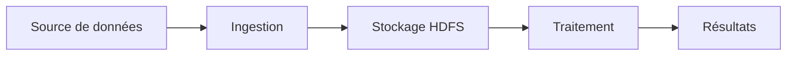

# Nom du projet

> Modèle : copier ce dossier en `projets/nom-du-projet/`.

| | |
|---|---|
| **Contexte** | Projet du module Big Data — individuel / binôme (noms) |
| **Problème traité** | |
| **Données** | Source, volume, format |
| **Technos** | |
| **Statut** | ⏳ En cours / ✅ Terminé — JJ/MM/AAAA |

## Architecture



## Lancer le projet

```bash
```

## Démarche

1. 

## Résultats

## Ce que j'ai appris

## Limites et améliorations

## Livrables

- Rapport : `rapport.pdf`
- Présentation : `presentation.pdf`
